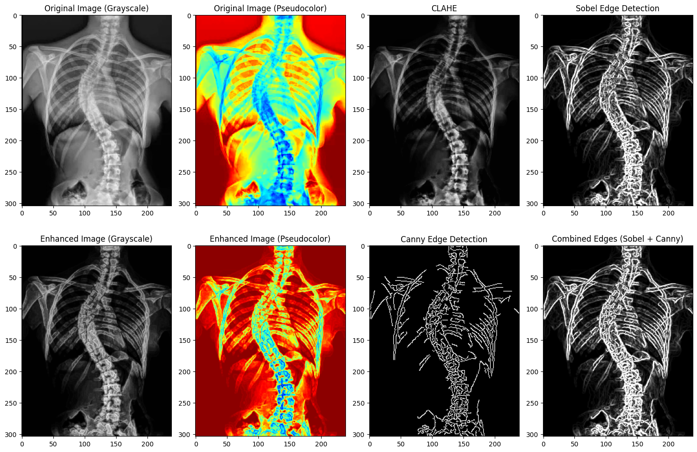
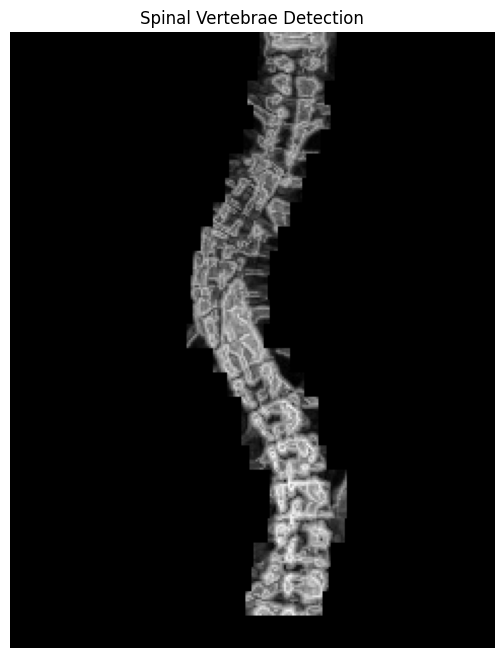
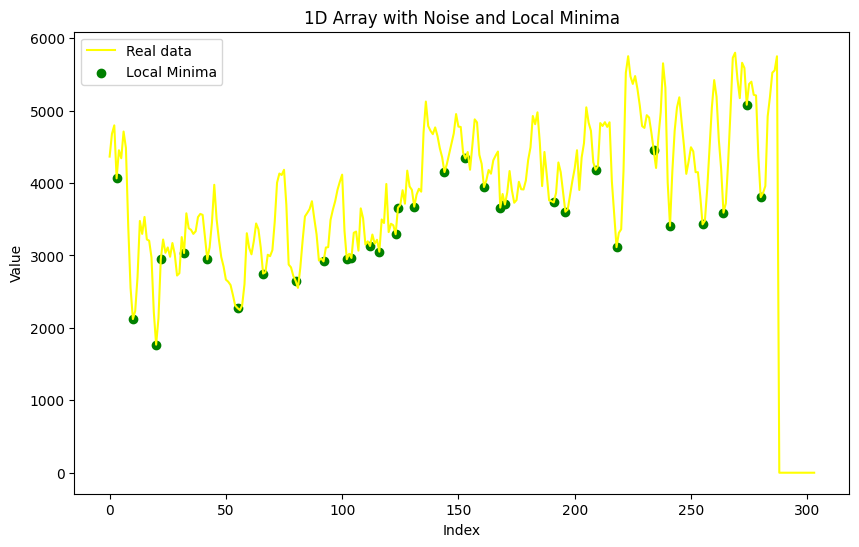
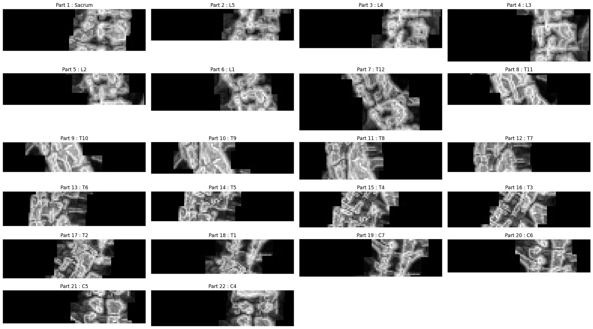

# Vertebra segmentation from a frontal spine X-ray

Notebook: [`spine_segmentation.ipynb`](spine_segmentation.ipynb)

Group term project (3 members). I designed the vertebra-splitting algorithm (Part 3).

## Overview

Given a frontal full-spine X-ray, split the spine into one image per vertebra and label each crop from the sacrum up to C1. The method uses classical image processing only, with no trained model, so every step can be inspected and explained.

## Pipeline

**Part 1: enhancement.** Gamma correction (gamma 4.5) is applied first, then CLAHE (clip limit 3, 8 by 8 tiles) boosts local contrast. Sobel and Canny edge maps are combined and blended back into the image (weights 0.7 and 0.3). The notebook also renders the original and enhanced image with a JET color map to make bone structure easier to see.

**Part 2: isolating the spine column.** The image is cropped to its central region (width divided by 2.5) and cut into horizontal strips of height // 25 rows. The loop runs 25 times, but the strip position only advances for the first 24 passes, so the 25th pass repeats the 24th strip and the rows below 24 x (height // 25) are left black. In each strip the brightest region is kept through a mask, and everything else is set to black. The strips are then placed back on a black background, which leaves only the spine.

**Part 3: splitting into vertebrae.** Columns outside a central band are zeroed and the pixel values of each row are summed. The row profile is smoothed with a moving average (window of height divided by 50), and its local minima are taken as the gaps between vertebrae. Each smoothed minimum is snapped to the lowest raw row sum within height divided by 100 rows. The image is then cropped between consecutive cut points with a small margin, and segments shorter than height divided by 40 are skipped. Cut points are processed from the bottom up, so the crops are labelled `Sacrum, L5 ... L1, T12 ... T1, C7 ... C1`.

## Results

The stored outputs show each stage: the enhancement panels, the isolated spine, the cut points on the row profile, and the individual crops. The evaluation is qualitative only. The stored run produced 22 crops, labelled from the sacrum up to C4, so no crops were made for C3, C2 and C1.

**Part 1, pre-processing.** Original, CLAHE, edge maps and the enhanced image, in grayscale and pseudocolor:



**Part 2, spine isolation.** Only the brightest region of each strip is kept:



**Part 3, vertebra splitting.** Row sums of the isolated spine, with the cut points at the local minima:



**Output.** The crops, one per vertebra:



## Limitations

- Every constant (gamma, strip count, window sizes, thresholds) was set by hand, and the method was not validated on other images, so I would not expect it to transfer to other scanners or patient positioning without retuning.
- Only a frontal view was used, and the cervical vertebrae overlap in that view, so the upper crops are the least reliable.
- The vertebra labels are assigned by counting cut points from the bottom. A missed or extra cut point shifts every label above it.

## Data

The input X-ray files are not included as separate files. The notebook expects two images (`4.jpeg` and `Spine_Segments.jpeg`) in `/content/`, and the stored cell outputs show the results on them.

## Reproduce

```
pip install -r requirements.txt
```

Place your own frontal spine X-ray at the image paths used in the notebook (or edit them) and run the cells in order. The last cell writes the crops to a `spine_parts/` folder.
